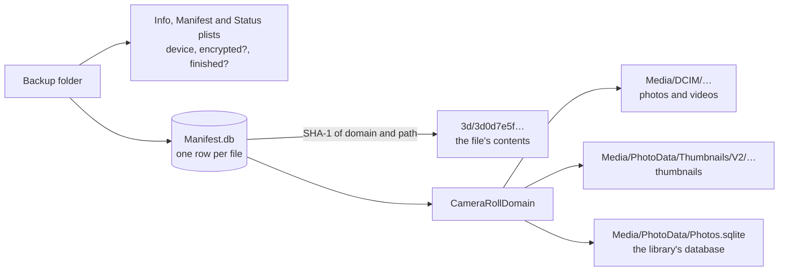
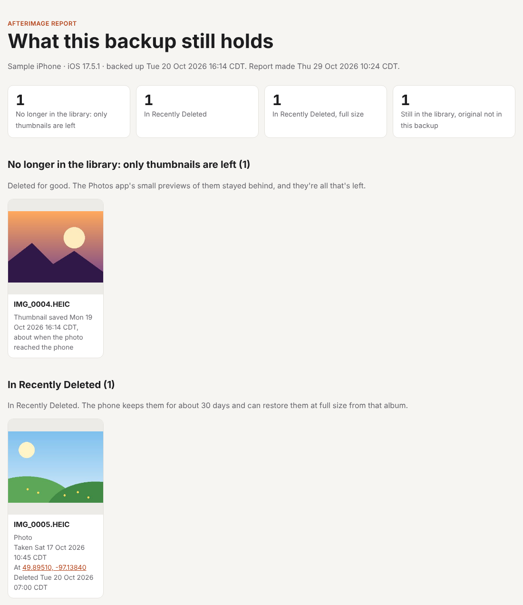
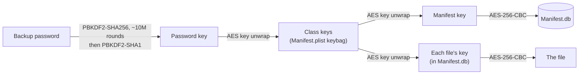

# Afterimage

[](https://github.com/omdkpatel810-ops/afterimage/actions/workflows/tests.yml)


[](LICENSE)

**Find the photos your iPhone backup still remembers.**

When you delete a photo on an iPhone, the small preview the Photos app made of it doesn't always go with it. Those previews, called thumbnails, end up in the backups your computer makes. Afterimage reads a backup, without changing anything in it, and shows what its camera roll holds: the photos and videos, their thumbnails, and the thumbnails whose photo is no longer there. Then it checks the Photos app's own database to say what became of each one, and when and where it was taken. And it can save them: each thumbnail with its date and place written back in, plus a report page to open in a browser. Encrypted backups open with their own password.

That's useful two ways:

- **Get back a lost photo**, as a small copy, when no other copy is left.
- **Check your own privacy**: see what a backup still holds that you thought was deleted.

> **Status: milestone 4 of 5 is done.** Afterimage finds backups, opens encrypted ones with their password, uses the Photos database to tell deleted photos from ones in Recently Deleted or kept in iCloud, and saves what's left with a report page ([roadmap](#roadmap)).

```text
$ afterimage photos --list
Om's iPhone · iOS 17.5.1 · backed up Tue 20 Oct 2026 16:14 CDT

Camera roll in this backup:
  Photos and videos      3  2 photos, 1 video, 5.4 KB
  Thumbnails             8  for 6 photos and videos
  Thumbnail tables       1  .ithmb files, many thumbnails in each
  Edited versions        1
  Photos database    found  5 photos and videos, 2 in Recently Deleted, 1 hidden
  Other files            2

3 photos and videos with thumbnails but no original in this backup:
  No longer in the library: only thumbnails are left  1
  In Recently Deleted                                 1
  Still in the library, original not in this backup   1

1 photo or video in Recently Deleted is still in this backup at full size.

No longer in the library: only thumbnails are left (1):
  DCIM/100APPLE/IMG_0004.HEIC  2 thumbnails, saved Mon 19 Oct 2026 16:14 CDT

In Recently Deleted (1):
  DCIM/100APPLE/IMG_0005.HEIC  photo, taken Sat 17 Oct 2026 10:45 CDT, deleted Tue 20 Oct 2026 07:00 CDT, 1 thumbnail

Still in the library; the original isn't in this backup, usually because it's kept in iCloud (1):
  PhotoData/CPLAssets/group349/6F1E2D3C-4B5A-4978-8695-A4B3C2D1E0F9.JPG  photo, taken Tue 01 Jul 2025 11:20 CDT, at 51.04470, -114.07190, hidden, first named IMG_4821.JPG, 1 thumbnail

In Recently Deleted, still in this backup at full size (1):
  DCIM/100APPLE/IMG_0003.MOV  video, taken Sun 18 Oct 2026 20:10 CDT, deleted Mon 19 Oct 2026 17:00 CDT

Recently Deleted keeps photos for about 30 days. Until then, the phone can restore them at full size from that album in the Photos app.
```

<sub>From the fake backup the tests build, so the numbers are small.</sub>

## How a backup is laid out



1. **Every file is renamed.** A backup stores each file under the SHA-1 of its domain (the app or part of iOS it belongs to) and its path, in a subfolder named after the first two characters. `HomeDomain-Library/SMS/sms.db` becomes `3d/3d0d7e5fb2ce288813306e4d4636395e047a3d28`. `Manifest.db` maps the names back.
2. **Each file's details are an archived object.** `Manifest.db` keeps a file's size and dates as an `MBFile` object in Apple's NSKeyedArchiver format. Afterimage reads it with its own small decoder ([`keyedarchive.py`](afterimage/keyedarchive.py)), using only Python's standard library.
3. **Thumbnails are filed under their photo's path.** `Media/PhotoData/Thumbnails/V2/DCIM/100APPLE/IMG_0001.HEIC/5005.JPG` is a thumbnail of `Media/DCIM/100APPLE/IMG_0001.HEIC`. So a thumbnail whose original isn't in the backup stands out. Either the photo was deleted, or it's kept in iCloud and the phone held only a small copy until it was opened.
4. **The Photos database says which.** `Photos.sqlite` has a row for every photo and video in the library: its folder and file name, when it was taken (in seconds since 2001, Apple's clock), where, and whether it's in Recently Deleted. The table is `ZASSET`, or `ZGENERICASSET` before iOS 14. When a photo is deleted for good, its row goes too. So for each thumbnail whose original isn't in the backup:

| The Photos database has… | What it means | What Afterimage says |
| --- | --- | --- |
| no row for it | deleted for good; the thumbnail is all that's left | No longer in the library: only thumbnails are left |
| a row marked as trashed | in Recently Deleted, which keeps it about 30 days | In Recently Deleted |
| a row, not trashed | still in the library; the original is usually in iCloud | Still in the library, original not in this backup |

It also finds the other way round: photos in Recently Deleted whose full-size original is still in the backup.

## Saving what's left

```text
$ afterimage export --out afterimage
Saved 4 files to afterimage:
  No longer in the library: only thumbnails are left  1  only-thumbnails-left/
  In Recently Deleted                                 1  recently-deleted/
  In Recently Deleted, full size                      1  recently-deleted-full-size/
  Still in the library, original not in this backup   1  still-in-library/
Wrote the date taken or place into 2 thumbnails.

Open report.html in your browser to see them all; afterimage.csv lists them for a spreadsheet.
This folder holds copies of your photos. Keep it private, and delete it when you're done.
```

```text
afterimage/
├── only-thumbnails-left/IMG_0004 (thumbnail).jpg
├── recently-deleted/IMG_0005 (thumbnail).jpg
├── recently-deleted-full-size/IMG_0003.MOV
├── still-in-library/IMG_4821 (thumbnail).jpg
├── afterimage.csv
└── report.html
```

- **One folder for each thing that could have happened to a photo**, so the ones deleted for good are easy to find.
- **The sharpest thumbnail.** A photo can have several; the biggest is saved.
- **The date and place go back in.** Thumbnails in a backup usually carry no date or location, so a photo app would file them under the day they were saved. Afterimage writes the date taken and the GPS position into each one as Exif, with its own small writer ([`exif.py`](afterimage/exif.py), standard library only). The file's time is set to the date taken too. A thumbnail that already has Exif is left as it is, so nothing in it (such as which way up it goes) is lost.
- **The name it was taken with.** iCloud stores photos under long IDs like `6F1E2D3C-….JPG`. The database remembers the camera's name, so that one is saved as `IMG_4821 (thumbnail).jpg`.
- **Full size where it still can be.** A photo in Recently Deleted whose original is still in the backup is copied whole, not as a thumbnail.

`report.html` shows everything with its date, place (linked to OpenStreetMap) and what to do next. It loads nothing from the internet, so it works offline and nobody learns it was opened.



<sub>The report page for the fake backup the tests build. The pictures are drawn by the tests.</sub>

## Encrypted backups

An encrypted backup is the safer kind to keep, and Afterimage opens it with its backup password: the one chosen when "Encrypt local backup" was turned on, which isn't the phone's passcode. It asks for it without showing what you type, or reads it from standard input with `--password-stdin`.



1. **The password unlocks a keybag.** `Manifest.plist` holds a keybag of "class keys", each wrapped (AES key wrap, RFC 3394) with a key made from the password. Making that key takes two rounds of PBKDF2, the first about ten million iterations long, so unlocking takes a few seconds. That's Apple's defence against guessing, and Afterimage doesn't try to get around it: it only ever uses the password it's given.
2. **The class keys unlock the list of files, then each file.** `Manifest.db` is encrypted with its own key, wrapped by a class key. Each file has its own key too, kept wrapped in its `Manifest.db` record. Afterimage reads the keybag with its own code ([`crypto.py`](afterimage/crypto.py)). The password steps use the standard library; the AES steps use the [`cryptography`](https://cryptography.io) package, the one optional dependency.
3. **Nothing is kept.** The password is used once, to make the key. The decrypted `Manifest.db` goes in a private temporary folder that's deleted when the backup is closed, and other files are decrypted as they're read. The backup itself still isn't changed.
4. **Checked against an independent decrypter.** The tests build encrypted backups the way Apple does, then check that every file Afterimage decrypts matches what [iphone_backup_decrypt](https://github.com/jsharkey13/iphone_backup_decrypt), an established open-source tool, gets from the same backup.

## Built to only read

- **Manifest.db is opened read-only and "immutable"**, so SQLite writes nothing, not even a lock or journal file.
- **Photos.sqlite is read from a copy.** It's copied to a temporary folder together with its write-ahead log (`Photos.sqlite-wal`), so the latest changes still waiting in the log are read too. The copy is deleted afterwards.
- **Names from the manifest are checked before they're used as paths.** Only 40 hex characters are accepted, so a tampered backup can't point outside its folder with something like `../../`.
- **Exports never go inside the backup**, or into a folder that already has files in it, so nothing is overwritten.
- **Names from the backup are made safe before they become file names.** Slashes, `..`, characters Windows forbids and names like `CON` are replaced, so a strange name can't write anywhere else.
- **A test proves nothing changes.** It fingerprints every file and folder in a backup (contents and modified times) before and after every command.
- **It never prints the phone's serial number, IMEI or phone number,** though the backup has them. A test checks that too.

## Quick start

Requires Python 3.10 or newer, and nothing else: only the standard library is used.

**1. Make a backup.** Connect your iPhone, open Finder (Mac) or the Apple Devices app or iTunes (Windows), and back it up to this computer. Encrypted or not, both work.

**2. Run it.**

```bash
git clone https://github.com/omdkpatel810-ops/afterimage.git
cd afterimage
python3 -m venv .venv && source .venv/bin/activate
pip install -e ".[encrypted]"   # or just -e . if your backups aren't encrypted

afterimage list               # the backups on this computer
afterimage info               # one backup's device, date and contents
afterimage photos --list      # what its camera roll holds
afterimage export --out ~/Desktop/afterimage   # save what's left, with a report page
```

With more than one backup, name one by its device name, or the start of its folder name: `afterimage photos "Om's iPhone"`. You can also give a backup's folder directly.

Afterimage looks for backups where Apple's tools keep them:

| Computer | Folder |
| --- | --- |
| Mac | `~/Library/Application Support/MobileSync/Backup` |
| Windows: Apple Devices app, or iTunes from the Microsoft Store | `%USERPROFILE%\Apple\MobileSync\Backup` |
| Windows: iTunes from apple.com | `%APPDATA%\Apple Computer\MobileSync\Backup` |
| Linux | wherever `idevicebackup2` saved it; give the path or `--dir` |

On a Mac, macOS keeps that folder private: give your terminal app **Full Disk Access** (System Settings → Privacy & Security → Full Disk Access) first. Afterimage says so if it's blocked.

## What it can't do

- **Bring back the full-size original.** Once a photo is permanently deleted, the original is gone. What can remain is a thumbnail: a small preview, not the photo.
- **Promise there's anything left.** Whether leftover thumbnails exist depends on the iOS version, iCloud Photos settings, and how long ago the photo was deleted.
- **Open an encrypted backup without its password.** There's no guessing and no way around it.
- **Read backups made by iOS 9 or earlier.**
- **Read a phone directly.** It reads backups that are already on your computer.

## Use it on your own backups

Afterimage is for backups of your own devices, or ones whose owner has asked you to look. It doesn't get around passwords or encryption, and it never will: an encrypted backup needs its own backup password, the one Finder or iTunes asked for when encryption was turned on. It doesn't guess passwords, and it refuses a backup whose key settings have been tampered with to make it work for hours.

## Tests

```bash
pip install -e ".[dev]"
python -m pytest --cov     # 185 tests, 100% coverage; fails under 95%
ruff check . && ruff format --check .
```

The tests never use a real phone or a real photo. (Pillow, used only by the tests, reads back the Exif Afterimage writes, the way a photo app would.) They build backups in code, shaped like the ones Apple's tools make ([`tests/conftest.py`](tests/conftest.py)), and run on Linux, macOS and Windows. Among them:

- **File names match the published ones.** The SHA-1 names for `sms.db`, the contacts database and `Photos.sqlite` are checked against the ones forensic tools look up.
- **Nothing is written,** by any command (see above).
- **Tampered names can't escape the folder.** Manifest entries like `../../secret.txt` are refused.
- **The write-ahead log is read.** A fake Photos database keeps its rows only in `Photos.sqlite-wal`, as a phone can. Afterimage finds them, and the same database without its log has none.
- **Photo apps can read what's written.** Pillow reads back every date and place written into a saved thumbnail. A property-based test (Hypothesis) checks that any place on Earth comes back to within about 3 cm.
- **The report can't be tricked.** A photo named `` and a phone named `<b>Om</b>` show up as text on the page, and as harmless file names.
- **Encrypted and plain backups tell the same story.** The same camera roll, backed up both ways, gives exactly the same report, and every decrypted file matches [iphone_backup_decrypt](https://github.com/jsharkey13/iphone_backup_decrypt).
- **Bad passwords and damaged backups fail clearly.** A wrong password, a tampered keybag, a truncated file or a missing key each get a plain message, and a damaged photo is left out of an export instead of stopping it.
- **Older iPhones work too.** The `ZGENERICASSET` table from iOS 13 and earlier reads the same as `ZASSET`.
- **Path prefixes match exactly.** A property-based test (Hypothesis) checks that case counts and that `%` and `_` are ordinary characters, both of which SQL's `LIKE` gets wrong.
- **Any file record reads back.** Another property-based test archives random paths, sizes and dates, in any language, and decodes them.

## Roadmap

- [x] **1. Read a backup:** find it, read Manifest.db, list its photos and thumbnails without changing anything
- [x] **2. Match thumbnails to Photos.sqlite:** dates, places, and which photos were deleted
- [x] **3. Export:** save the leftover thumbnails with their dates and places, plus a privacy report page
- [x] **4. Encrypted backups,** unlocked with the owner's own backup password
- [ ] **5. Ship it**

## Background

Thumbnails outliving their photos isn't new. Forensic examiners have used them for years, and in 2013 a bug made deleted photos' thumbnails reappear in the iOS 7 Photos app ([AppleInsider](https://appleinsider.com/articles/13/11/14/bug-resurrects-deleted-image-thumbnails-in-ios-7-photos-app-dates-back-to-ios-5)). The `Thumbnails/V2` layout is discussed on [Forensic Focus](https://www.forensicfocus.com/forums/general/file-path-question-please-advise-iphone-var-mobile-media-photodata-thumbnails-v2-photodata-cplassets). Scott Koenig's [Photos.sqlite research](https://theforensicscooter.com/2022/05/02/photos-sqlite-query-documentation-notable-artifacts/) documents the database, including that a photo deleted for good loses its row. Commercial tools such as [Decipher Backup Browser](https://deciphertools.com/blog/photo-metadata-backup-thumbnail-photos/) export these thumbnails from backups. Afterimage is an open-source take: it shows its reasoning, and says what it can't tell.

## License

[MIT](LICENSE) © 2026 Om Patel
